# RESULTS

All numbers come from `outputs/tables/`; figures are in `outputs/figures/`.
Times are UK local time unless stated otherwise.

---

## Part 2: washing-machine exploratory analysis

**Homes and periods.** Official cleaned REFIT data, 1-minute resolution, houses **1, 2, 7, 9, 10, 15**
over their full records (Sep 2013 – Jul 2015; 3,056.6 usable house-days in total). The test houses
of the model (8, 17) are deliberately left out of the EDA, so the cycle rule is not tuned on them.

### Cycle rule (plain language)

> A minute counts as **active** when the washing machine averages more than **20 W**. Active
> stretches separated by a pause of **less than 10 minutes** are the same wash (the drum stops while
> soaking or draining); a pause that contains missing data is never bridged. A cycle must last
> **at least 10 minutes** and use **at least 50 Wh**; anything smaller is door-lock, display or
> standby noise.

This mirrors the "on-power threshold + minimum on/off duration" way of defining appliance
activations in Kelly & Knottenbelt (2015). It holds up: in every house, the detected cycles contain
**98.3–99.7 %** of all WM energy (`eda_wm_summary.csv`), so almost nothing real is thrown away.

**Sensitivity** (`eda_wm_sensitivity.csv`, [figure](outputs/figures/eda_wm_sensitivity.png)):

| Cycles per week | H1 | H2 | H7 | H9 | H10 | H15 |
|---|---|---|---|---|---|---|
| on threshold 5 W | 4.96 | 4.96 | 11.11 | 3.61 | 8.07 | 3.68 |
| **20 W (chosen)** | **5.01** | **5.06** | **11.18** | **3.61** | **8.08** | **3.68** |
| 50 W | 4.99 | 5.23 | 11.35 | 3.61 | 8.08 | 3.68 |
| 100 W | 4.99 | 5.94 | 12.99 | 3.67 | 8.63 | 3.75 |
| merge gap 0 min (no merging) | 5.80 | 5.23 | 12.78 | 3.91 | 14.89 | 4.71 |
| merge gap 30 min | 4.61 | 4.67 | 10.47 | 3.42 | 7.56 | 3.47 |

The threshold hardly matters between 5 and 50 W. At 100 W, quiet tumbling phases start to break
one wash into two (Houses 2 and 7). The merge gap matters more: without merging, House 10's count
nearly doubles because its machine pauses for 1–5 minutes mid-wash. Anything from 5 to 30 minutes
gives stable counts.

### Availability and quality (`eda_wm_summary.csv`)

| House | Period | Usable days | Missing % | Outages > 5 min | Longest outage | WM off (≤ 20 W) % | Cycles | Per week |
|---|---|---|---|---|---|---|---|---|
| 1 | 2013-10-09 → 2015-07-10 | 558.8 | 12.54 | 406 | 41.6 d | 98.12 | 400 | 5.01 |
| 2 | 2013-09-17 → 2015-05-28 | 465.8 | 24.56 | 463 | 62.0 d | 95.32 | 337 | 5.06 |
| 7 | 2013-11-01 → 2015-07-08 | 536.6 | 12.48 | 118 | 41.6 d | 91.62 | 857 | 11.18 |
| 9 | 2013-12-17 → 2015-07-08 | 481.2 | 15.28 | 79 | 41.6 d | 97.32 | 248 | 3.61 |
| 10 | 2013-11-20 → 2015-06-30 | 523.3 | 10.85 | 788 | 8.6 d | 91.28 | 604 | 8.08 |
| 15 | 2013-12-17 → 2015-07-08 | 490.8 | 13.50 | 691 | 8.6 d | 97.08 | 258 | 3.68 |
| **pooled** | | 3,056.6 | 14.91 | | | 95.09 | **2,704** | 6.19 |

The machine is off for 91–98 % of usable minutes. Exact zeros are a smaller share in House 7
(74.9 % of minutes) because its machine has a standby draw of a few watts.

### Plot (i): a representative 24 hours

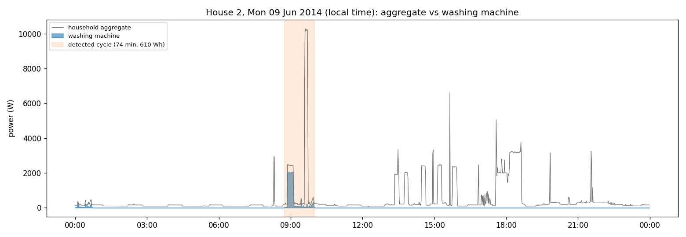

House 2, Monday 9 June 2014. The day was chosen automatically: a day with complete data, one wash,
and that wash's energy closest to the house median. The 74-minute, 610 Wh wash at 08:45 is clearly
visible in the aggregate only during its ~2 kW heating phase. While it runs, a separate ~10 kW
appliance (most likely an electric shower) dominates the whole-house signal, and the afternoon has
several other 2–3 kW loads that look just like the WM heater. This is why disaggregating the WM is
hard: its most visible feature is not unique.

### Plot (ii): detected cycles

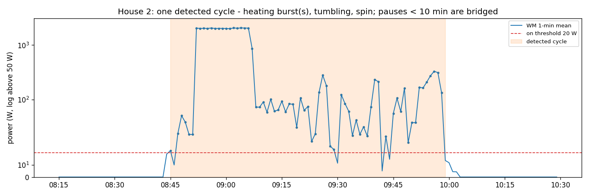

The same wash in detail: a short fill, about 15 minutes of heating at ~1.9 kW, then 50–300 W of
tumbling and spinning. Several brief dips below 20 W are bridged by the 10-minute merge rule. The
heating phase is where most of the energy goes.

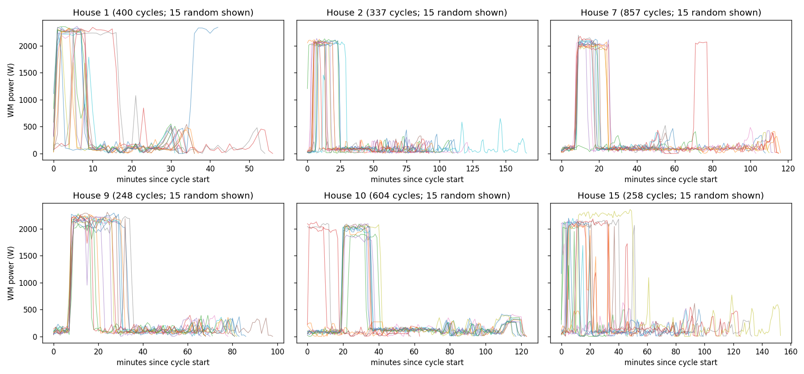

Fifteen random cycles per house, aligned at their start. Every house shows heater-then-tumble, but
the machine and programme mix differ: House 10 almost always runs the same ~120-minute programme
(heating at 20–35 minutes), House 1 runs short ~33-minute washes, and House 15 varies most.

### Usage patterns: hour of day and day of week

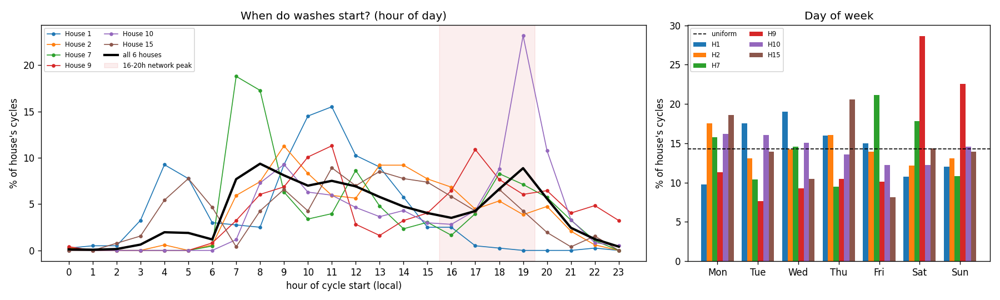
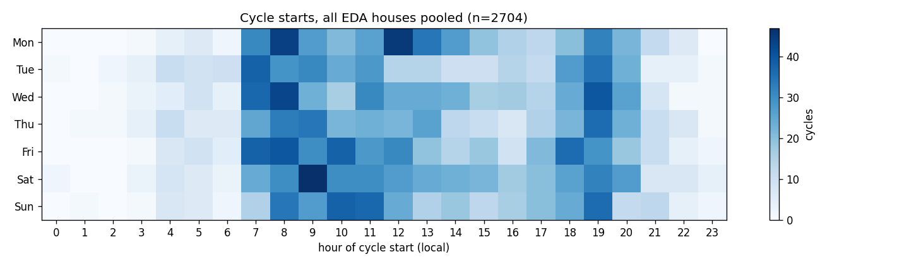

- **Pooled over the six houses** (`eda_wm_hourly_share_pct.csv`), 39.7 % of washes start
  between 07:00 and 11:59 and 21.1 % between 18:00 and 20:59 (19:00 alone is 8.9 %). Only 6.0 %
  start between midnight and 06:59.
- **Weekday evening peak:** 16.2 % of all washes start on a weekday between 16:00 and 19:59,
  ranging from **2.2 % (House 1) to 29.0 % (House 10)**; 23 % of House 10's washes start at
  19:00 alone.
- **Night-time timer use:** Houses 1 and 15 often start at 04:00–05:00, which looks like a
  delay-start timer on a night-rate tariff. House 1 never starts after 17:00.
- **Day of week:** 29.0 % of washes are at weekends overall (2/7 = 28.6 % if evenly spread), but
  House 9 does **51.2 %** of its washes at weekends, while the others spread them across the week.

### Plot (iii): cross-house comparison

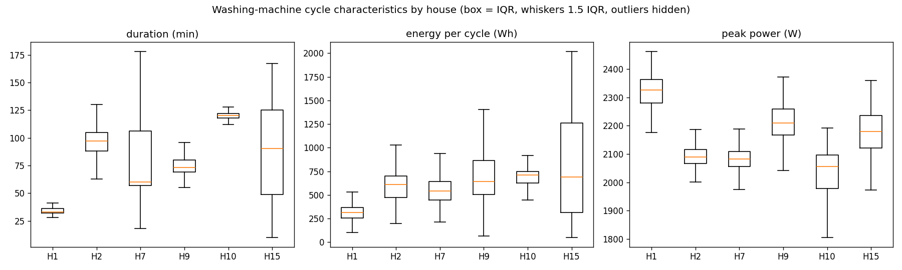

| House | Median duration | Median energy | Median peak | WM share of house energy |
|---|---|---|---|---|
| 1 | 33 min | 317 Wh | 2,326 W | 2.28 % |
| 2 | 97 min | 610 Wh | 2,090 W | 3.93 % |
| 7 | 60 min | 541 Wh | 2,083 W | 6.76 % |
| 9 | 73 min | 642 Wh | 2,210 W | 2.61 % |
| 10 | 120 min | 711 Wh | 2,056 W | 4.26 % |
| 15 | 91 min | 688 Wh | 2,180 W | 6.74 % |

**Peak power is almost the same everywhere** (2.05–2.33 kW: it is set by the heater element),
whereas **duration and energy per wash vary several-fold between homes** (median 317–711 Wh;
House 15's middle half spans about 300–1,250 Wh). For a model this means the peak height
transfers between houses but the cycle shape and length do not.

---

## Part 3: disaggregation model

**Task.** Estimate WM power (W) each minute from the household aggregate, using official cleaned
data at 1-minute resolution.

**Homes and periods** (`model_split.csv`):

| Role | Houses | Data used |
|---|---|---|
| Train | 2, 7, 10, 15 | first 80 % of each record, i.e. up to 2015-01-24 (H2), 2015-03-07 (H7), 2015-03-05 (H10), 2015-03-16 (H15) |
| Time-split test | 2, 7, 10, 15 | last 20 %, starting 1 day after each cut-off, to the end of the record (≈ 79–105 evaluated days per house) |
| Validation | 9 | full record 2013-12-17 → 2015-07-08 |
| Test (unseen houses) | 8, 17 | full records 2013-11-01 → 2015-05-11 and 2014-03-06 → 2015-06-19 |

**Data filters** (`model_excluded_minutes.csv`):
- **Stuck aggregate:** where the aggregate is exactly flat for an hour or more (a stuck,
  forward-filled sensor, DATA.md §5), it is set to missing, so those minutes are neither used as
  inputs nor scored. This removes 7.99 % of House 10's minutes, 4.73 % of House 9's,
  2.16 % of House 17's and 0.57–1.01 % elsewhere.
- **Other dropped minutes:** those with a missing aggregate or WM reading, or with WM > aggregate.

That leaves 2,286,286 training minutes, of which 146,129 (6.4 %) have the WM on (> 20 W).

### Approach

**Inputs (Seq2Point idea).** The target is the WM power at minute *t*; the inputs summarise the
aggregate in a window **t − 60 … t + 60 min**, both before and after *t*:
- changes relative to *t* at ±1, 2, 3, 5, 10, 15, 30, 60 min, and one-step differences;
- centred rolling mean, standard deviation, max, min, height above the window minimum, total
  absolute change and largest step, over 5, 15, 31, 61 and 121 minutes;
- the share of the window spent 1.5–2.6 kW above the window floor (the heater signature);
- **steady-load shape**: how long the current high-power stretch lasts, the share of the window
  that is both high and perfectly flat, and the number of large (> 500 W) steps. A WM heater burst
  lasts ~10–25 min surrounded by tumbling flicker, while storage or immersion heaters stay high and
  flat for an hour or more.

**Feature-set choice on validation** (`model_feature_set_selection.csv`; single regressor):

| Feature set | Features | Validation RMSE | Validation on/off F1 (30 W) |
|---|---|---|---|
| all (incl. time of day, day of week) | 68 | 143.1 W | 0.392 |
| **no time features (chosen)** | 64 | **142.7 W** | **0.405** |
| shape only (no time, no absolute power levels) | 48 | 146.1 W | 0.397 |

Always-off scores 166.7 W RMSE on validation. Clock-time features are dropped: they encode the
training houses' own habits and do not carry over to a new house. Absolute power levels are kept;
once the steady-load features were added they helped on validation.

**Models compared.** All use LightGBM (600 trees, learning rate 0.05, 63 leaves, seeded and
deterministic). There is no early stopping: the validation error curve is almost flat, so early
stopping stops after ~15 trees, which at this learning rate only moves predictions about halfway
(1 − 0.95¹⁵ ≈ 54 %) from the mean towards the target.

1. **Single regressor:** predicts WM power directly; set to 0 below a 50 W threshold chosen on
   validation (`model_threshold_tuning.csv`). Because ~94 % of training minutes are "off", it
   learns to predict the 2 kW heater far too low.
2. **Two-stage:**
   - a **classifier** estimates P(WM on); the WM counts as on above a cut-off of 0.5, chosen on
     validation from 0.2–0.7;
   - a **power regressor trained only on "on" minutes** gives the power when it is on, so the off
     minutes no longer pull the heater level towards 0.
3. **Cycle post-processing** (applied to either): predicted power is kept only where it forms a
   valid wash under the same rule as the ground truth (≥ 10 min, ≥ 50 Wh, pauses < 10 min merged).

**Final choice on the validation house only** (`model_final_choice.csv`), by on/off F1 (the
same criterion used throughout, fixed before seeing any test results):

| Validation house 9 | On/off F1 | Cycle F1 | Energy error | Daily energy MAE | MAE |
|---|---|---|---|---|---|
| single regressor | 0.424 | 0.420 | +53.1 % | 319.3 Wh | 24.15 W |
| single regressor + cycle post-processing | 0.497 | 0.420 | +40.5 % | 296.1 Wh | 22.26 W |
| two-stage | 0.604 | 0.642 | +11.3 % | 230.6 Wh | 16.96 W |
| **two-stage + cycle post-processing (final)** | **0.619** | **0.642** | **+3.3 %** | **221.1 Wh** | **15.85 W** |

Cycle F1 cannot separate the post-processed and raw versions, because the per-cycle metric
already applies the cycle rule to predictions.

### Baselines

- **Always off:** predicts 0 W. It is the honest floor for a mostly-off appliance and has a very low
  MAE.
- **Hour-of-day profile:** mean WM power by hour × weekday/weekend, learned from the training
  minutes. It is what you could do without any disaggregation.

### Metrics, and why

| Metric | Why it matters |
|---|---|
| **MAE (W)** per minute | standard, but dominated by the ~95 % of minutes when the WM is off, so always-off scores well |
| **Total energy error (%)** | what a utility report or bill-breakdown would show |
| **Daily energy MAE (Wh/day)** | is the per-day estimate usable for customer feedback? |
| **On/off precision / recall / F1** (truth on > 20 W, prediction on > threshold) | does the model know *when* the WM runs? |
| **Per-cycle precision / recall / F1** | event level: a true cycle is detected if any predicted cycle (same cycle rule) overlaps it; a predicted cycle is correct if it overlaps a true one. Closest to "how many washes did we spot". |

### Results (`model_metrics.csv`; "LightGBM" = final model `two_stage_cycles`)

**Unseen test houses 8 and 17** (924 evaluated days; pooled rows are computed from the two
houses' combined counts):

| Model | House | MAE | Energy error | Daily energy MAE | On/off P / R / F1 | Cycles true / predicted | Cycle P / R / F1 |
|---|---|---|---|---|---|---|---|
| always off | 8 | 29.31 W | −100 % | 677.2 Wh | 0 / 0 / 0 | 369 / 0 | – |
| hour profile | 8 | 54.38 W | **−9.3 %** | 616.5 Wh | 0.03 / 0.37 / 0.05 | 369 / 1358 | 0.10 / 0.40 / 0.16 |
| **LightGBM** | 8 | **22.02 W** | −52.1 % | **404.0 Wh** | 0.80 / 0.58 / **0.67** | 369 / 421 | 0.71 / 0.80 / **0.75** |
| always off | 17 | 10.05 W | −100 % | 232.5 Wh | 0 / 0 / 0 | 288 / 0 | – |
| hour profile | 17 | 34.72 W | +164.8 % | 445.2 Wh | 0.04 / 0.69 / 0.07 | 288 / 1229 | 0.16 / 0.73 / 0.26 |
| **LightGBM** | 17 | **5.45 W** | **−22.0 %** | **78.7 Wh** | 0.83 / 0.66 / **0.73** | 288 / 282 | 0.86 / 0.84 / **0.85** |
| always off | pooled | 20.32 W | −100 % | 469.9 Wh | 0 | 657 / 0 | – |
| hour profile | pooled | 45.21 W | **+30.9 %** | 536.7 Wh | 0.06 | 657 / 2587 | 0.21 |
| single regressor + post-proc. | pooled | 18.85 W | −26.9 % | 259.0 Wh | 0.62 | 657 / 1489 | 0.56 |
| two-stage, no post-proc. | pooled | 14.97 W | −40.4 % | **247.0 Wh** | 0.685 | 657 / 703 | **0.79** |
| **LightGBM (final)** | pooled | **14.29 W** | −45.1 % | 252.3 Wh | **0.695** (P 0.81, R 0.61) | 657 / 703 | **0.79** (P 0.77, R 0.82) |

**Within-house time split** (training houses, last 20 % of their records, 364.4 days):

| Model | MAE | Energy error | Daily energy MAE | On/off F1 | Cycle P / R / F1 |
|---|---|---|---|---|---|
| always off | 28.72 W | −100 % | 626.2 Wh | 0 | – |
| hour profile | 50.12 W | **−7.8 %** | 509.8 Wh | 0.17 | 0.27 / 0.75 / 0.40 |
| **LightGBM (final)** | **15.47 W** | −15.6 % | **184.6 Wh** | **0.74** | 0.74 / 0.91 / **0.82** |

Per house, on/off F1 is 0.64 (H2), 0.87 (H7), 0.57 (H10) and 0.89 (H15).

**Validation house 9:** LightGBM MAE 15.85 W (always-off 15.84 W), energy +3.3 %, on/off
F1 0.62, cycle F1 0.64.

**Interpretation.**

- **It is now a good wash detector.** In unseen houses it finds 82 % of washes, and 77 % of the
  washes it reports are real: 703 predicted vs 657 true, about 1.07 per real wash. On/off F1 is
  0.695 and cycle F1 0.79. Both baselines are far behind (on/off F1 ≤ 0.06, cycle F1 ≤ 0.21).
- **It beats always-off on per-minute MAE** in every test house, on future months and pooled
  (14.29 vs 20.32 W), and is level with it on validation (15.85 vs 15.84 W).
- **Total energy is not reliable: −45.1 % pooled** (House 8 −52.1 %, House 17 −22.0 %; future
  months −15.6 %; validation +3.3 %).
  - When a wash is detected, the heater level is now about right (actual-vs-predicted plot
    below). The missing energy comes from **whole washes that are missed**: on/off recall is 0.61
    and cycle recall 0.82.
  - House 8 often washes during busy mornings with an electric shower and other 4–7 kW loads.
    There the classifier stays silent rather than guessing.
  - The validation house had few such overlaps, so its +3.3 % did not transfer.
- **What the two-stage design bought** (pooled test rows above; same features and same
  post-processing for both):
  - predicted washes fell from 1,489 to 703, cycle F1 rose from 0.56 to 0.79, on/off F1 from
    0.62 to 0.695, and per-minute MAE from 18.85 to 14.29 W;
  - the cost is total energy (−26.9 % → −45.1 %);
  - the separate effect of the steady-load features is not isolated in the final pipeline, but
    `flat_high_frac61` is among the classifier's top ten inputs.
- **On total energy the hour-of-day profile scores better** in House 8 and on future months
  (−9.3 % and −7.8 %), but it has no idea *when* washes happen (on/off F1 0.05–0.16) and is
  off by +164.8 % in House 17. It is right on average for houses that resemble the training
  houses, not for individual homes.
- **Future months of known houses are easier than new houses** (on/off F1 0.74 vs 0.695; cycle
  F1 0.82 vs 0.79).

### Actual vs predicted on evaluation data

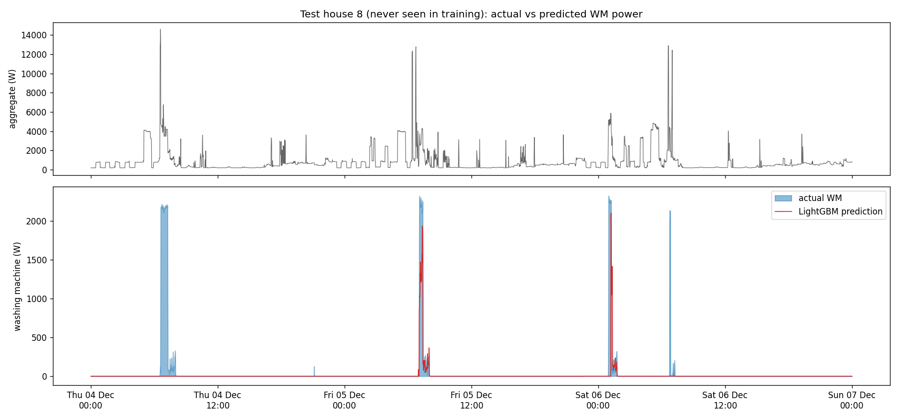

Test house 8, 4–6 December 2014 (window chosen automatically: starts on the day whose WM energy
is closest to the 75th percentile of days with use).
- **Detected:** two of the four washes, with the heater at about 1.9–2.1 kW against 2.2 kW
  actual.
- **Missed:** the other two, which start while 4 kW and 12–14 kW loads are running.
- **No false alarms** in this window.

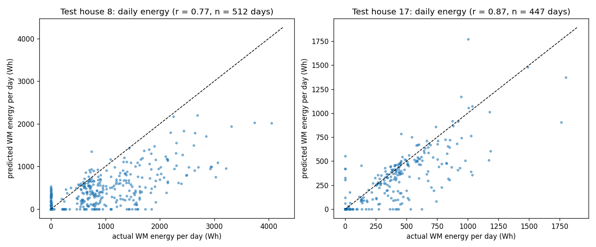

Daily WM energy on the test houses: correlation 0.77 (House 8, 512 days) and 0.87 (House 17,
447 days). Days with a detected wash sit near the diagonal. Days whose wash was missed sit on the
x-axis (predicted 0), which is where the energy shortfall comes from.

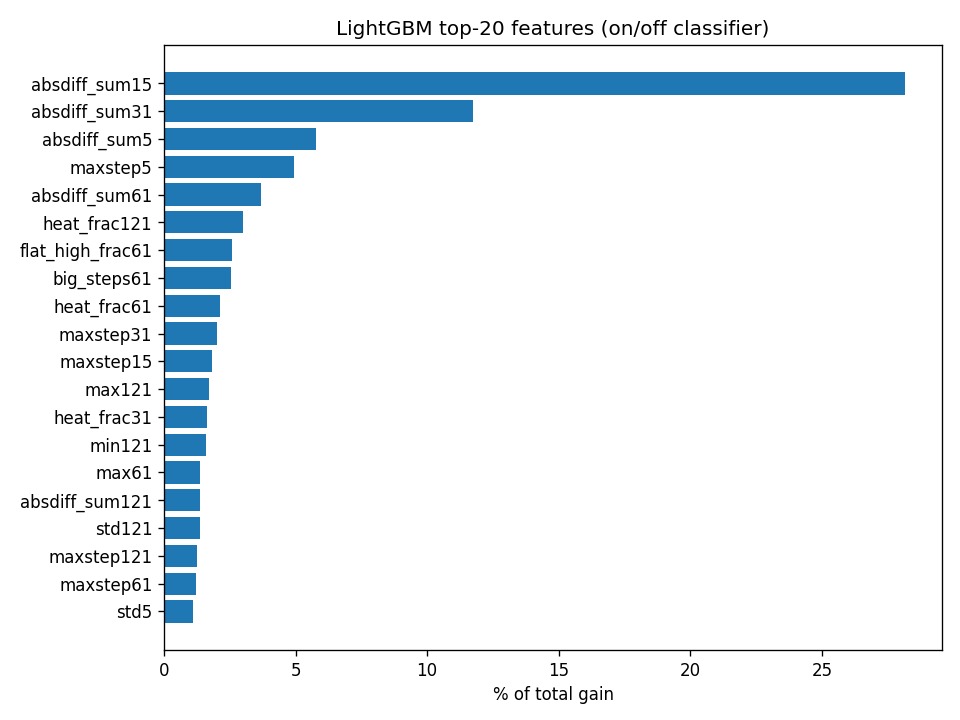

Feature importance of the on/off classifier, which decides when the WM runs. The top inputs are the
**total absolute change over 5–61 minutes** (`absdiff_sum15` alone is 28 %) and the largest
one-minute step. The classifier recognises the drum's minute-to-minute **flicker** (tumbling,
spinning) rather than just a 2 kW step, which is why it raises far fewer false alarms on smooth
heating loads. The new steady-load feature `flat_high_frac61` is in the top ten.

### Failure cases (`model_failure_cases.csv`)

**1. A cooking load looks like a wash (false positive).** House 17, 17 February 2015,
17:42–18:19: an evening load switching between 3.5 and 6 kW (most likely an oven or hob) is read
as a 707 Wh wash; true WM use is 0 Wh. It has both features the classifier looks for, a ~2 kW
step and rapid on/off cycling.

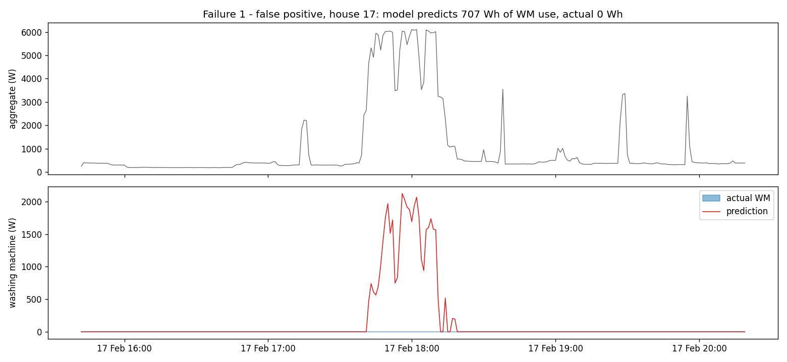

**2. A wash hidden under a busy morning (missed).** House 8, 11 December 2014, 07:03–08:11: a
1,107 Wh wash runs while the aggregate shows a 16 kW shower spike and 4–7 kW of other loads. The
heater step and the drum flicker are both buried, and the model predicts none of it. This is the
pattern behind most of House 8's −52 % energy error.

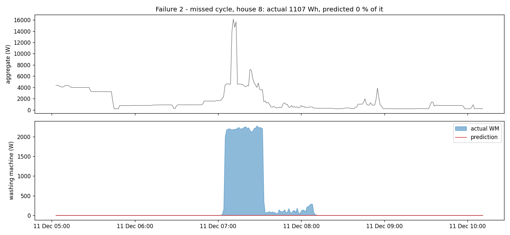

**Other situations where the model will struggle:**

- **Washes without a heating phase** (cold or 20 °C programmes, or machines that take hot water
  from the boiler): the main cue is missing.
- **Washer-dryers:** the drying phase looks like a long heater load.
- **Stuck or forward-filled aggregate data:** flat runs of 60+ minutes are filtered, shorter ones
  are not.
- **Houses whose base load or appliance mix differs a lot from the four training houses.**
